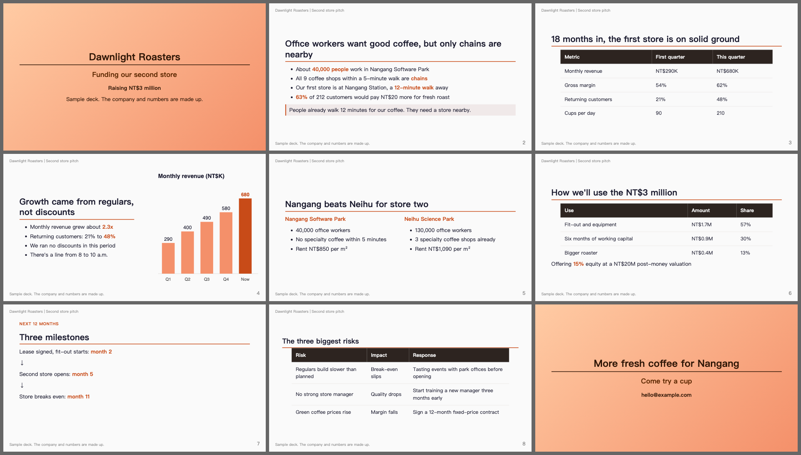
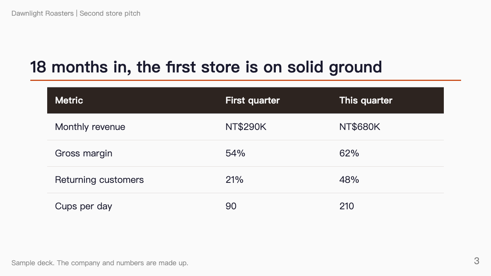
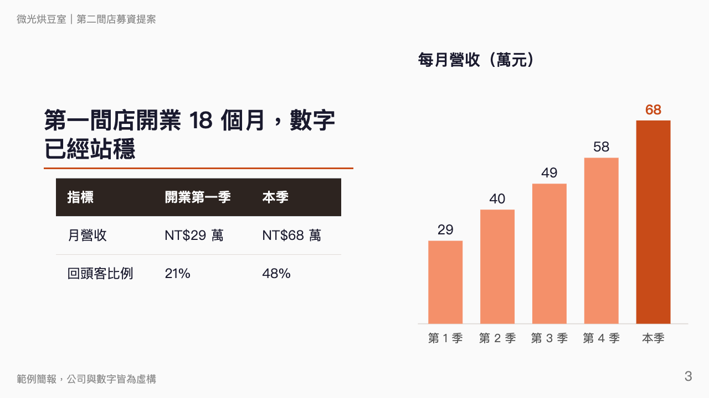

# AI Slide Maker

Tell AI what your talk is about. Get slides ready to present, then change any slide just by chatting.

I make every talk I give this way. It replaced PowerPoint, Google Slides, Canva and Notion for me, and my longest and most polished deck so far runs 82 slides.

Because a deck is one text file, AI can also scan every slide at once and catch small mistakes, such as a number that changed on one slide but not on another.

Most of the built-in checks started as mistakes in my own decks. I kept the lessons in a notes file until it reached 600 lines, then turned everything a program could check into code. Before publishing, I ran them on six of my own decks, 223 slides in all.

[繁體中文](README.zh-TW.md) | [简体中文](README.zh-CN.md)



*A sample deck made with this tool. The company and the numbers are made up. See [the source](examples/demo/slides.md) and [the PDF](examples/demo/slides.pdf).*

**Install:** paste this into Claude Code.

> Install the AI Slide Maker plugin from https://github.com/yyu0310/ai-slide-maker and check that this computer has Python 3, Node.js and Chrome.

## Change any slide by chatting

Say what you want in plain words. AI goes straight to that slide and changes only that part.

| You say | What happens |
| --- | --- |
| "Delete the table on slide 7" | Only that table goes |
| "Change every 'customers' to 'members'" | Every match changes, in the slides and in your speaker notes |
| "Make slide 3 text on the left and a chart on the right" | The layout changes and the rest stays |
| "Drop the third row of the risk table" | The row goes, and a title like "Three risks" gets updated too |

Here is one real change, on slide 3 of the sample deck: *"Make slide 3 text on the left and a chart on the right, and keep only two rows in the table."*

| Before | After |
| --- | --- |
|  |  |

### Why this works

Your whole deck is one text file. AI can find the exact line, search the whole file to confirm nothing was missed, and keep the layout clean because the look lives in one place. There are no boxes to nudge by hand.

The tool underneath is [Marp](https://marp.app), an open-source project that turns a text file into slides. You don't need to learn it.

## What you can do

| You want to | Do this | What happens |
| --- | --- | --- |
| Start a new talk | `/ai-slide-maker:new` | AI asks who it's for and how long you have, agrees an outline with you, then builds the slides |
| Change something | Just chat | AI finds the slide, makes the change and checks nothing broke |
| Get honest feedback | `/ai-slide-maker:review` | Three readers go through the deck: a skeptical expert, a first-time listener and you rehearsing |
| Get the final file | `/ai-slide-maker:export` | Runs the checks, then makes a PDF, and a PowerPoint file if you want one |

Every problem in a review quotes your deck word for word. A script confirms each quote really is in the file and gives you its line number, so you aren't chasing made-up issues.

The first draft of the sample deck got 30 findings, and all 30 quotes matched. One of them: one slide called the rent low, while the script for a later slide blamed high rent for the slower payback.

## Problems it catches before you present

| Problem | What you get |
| --- | --- |
| Too much content, so the bottom of a slide gets cut off with no warning | The slide number, how far it runs over and how to fix it |
| Text running into the header or footer | The slide number |
| Text too small to read when projected | The slide number |
| A note to yourself left on a slide, such as "to be confirmed" | The line, with a reminder to move it to your speaker notes |
| A leftover draft marker or template text | The line |
| A missing image | The line and the path |
| A file from outside the deck's folder, which would end up in your PDF | The line, and a stop before exporting |
| Speaker notes lost in the PowerPoint file | A count of how many slides kept their notes |

`/ai-slide-maker:export` also makes `slides.sheet.png`, one image of every slide side by side, so you can spot a bad slide at a glance.

## How I make a deck

I follow the same four steps for every talk:

1. **Topic and audience:** write one sentence saying who will learn what, in how much time.
2. **Outline:** pick a structure and settle each part's message, example and minutes.
3. **Slides:** build one part at a time, get a review, then export.
4. **On the day:** bring your own adapters and two backups, and arrive early.

Steps 1 and 2 are built into `/ai-slide-maker:new`. Read [the full workflow](docs/workflow.md).

## Install

### Let your AI do it

Paste the prompt at the top of this page into Claude Code.

### Do it yourself

Run these in your terminal:

```bash
claude plugin marketplace add yyu0310/ai-slide-maker
claude plugin install ai-slide-maker@ai-slide-maker
```

Then start a new Claude Code session and try `/ai-slide-maker:new`.

### What you need

Not sure you have these? Ask your AI to check and to help install anything that's missing.

| Item | Why |
| --- | --- |
| [Claude Code](https://code.claude.com) | Runs everything |
| Python 3.9 or later | Runs the checks |
| Node.js | Makes the slides. The first export downloads the slide tool, so you need internet once |
| Chrome, Chromium or Edge | Draws each slide to look for cut-off content. If yours is somewhere unusual, set `CHROME_PATH` |

### Where it works

| Setup | Status |
| --- | --- |
| Claude Code on macOS | Tested |
| Claude Code on Linux | Should work the same, not tested |
| Claude Code on Windows | Not tested. Set `CHROME_PATH` to your browser |
| Other AI coding tools, such as Codex or Gemini CLI | The template and scripts should work, not tested. The `/` commands are Claude Code only, so point your tool at [AGENTS.md](AGENTS.md) |
| claude.ai in a browser | Doesn't work, because the plugin needs to run programs on your computer |

## Limitations

- Each slide in the PowerPoint file is a picture. The layout matches exactly and your speaker notes are kept, but you can't edit the text in PowerPoint. Change the deck and export again.
- PDFs have no animation.
- Videos can't be embedded. Add them in PowerPoint by hand.
- The look is clean and simple. Heavily designed, brand-led decks are a poor fit.
- A deck can ask for files anywhere on your computer, and the export would copy them in. The checks stop on these, so read that warning before you export a deck someone else gave you.
- The checks look at layout and leftovers. They can't tell whether your argument is right, which is what `/ai-slide-maker:review` is for.

## More

- [Slide guide](docs/guide.md): when to split a slide, where images go, and what each check means
- [Template](template/slides.md)

## Credits

Built on [Marp](https://marp.app) by the Marp team. The overflow tolerance and fix suggestions follow [CopilotAtelier](https://github.com/raandree/CopilotAtelier), and the small-text check follows [minorun-marp-skill](https://github.com/minorun365/minorun-marp-skill).

## License

[MIT](LICENSE)
