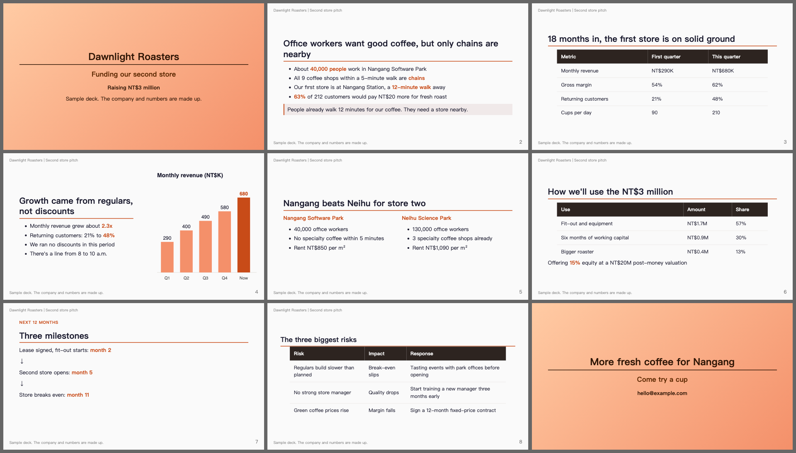
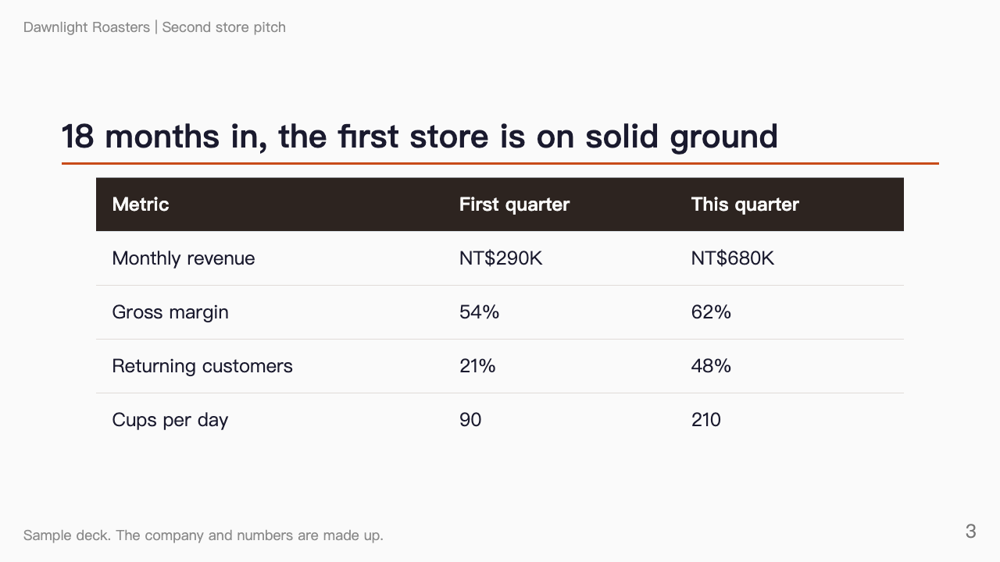

# AI Slide Maker

告诉 AI 你要讲什么，它做出能直接上台的幻灯片。之后想改哪一页，用说的就好。

[English](README.md) | [繁體中文](README.zh-TW.md)



*用这个工具做的示例演示，公司与数字均为虚构。可以看[源文件](examples/demo/slides.md)和 [PDF](examples/demo/slides.pdf)。*

**安装：** 把这段贴进 Claude Code。

> 帮我安装 AI Slide Maker 这个 plugin：https://github.com/yyu0310/ai-slide-maker ，并确认这台电脑有 Python 3、Node.js 和 Chrome。

## 想改哪页，用说的

用平常说话的方式讲就好。AI 会直接找到那一页，只改你说的地方。

| 你说 | 结果 |
| --- | --- |
| “删掉第 7 页的表格” | 只有那张表格被删掉 |
| “把所有‘客户’换成‘会员’” | 幻灯片和讲稿里的全部换掉 |
| “第 3 页改成左文右图” | 版面换掉，其他内容不动 |
| “风险表格的第三行拿掉” | 那一行删掉，标题的“三个风险”也一起更新 |

下面是一次真实修改，对象是示例演示第 3 页：*“第 3 页改成左文右图，表格只留两行。”*

| 修改前 | 修改后 |
| --- | --- |
|  |  |

### 为什么改得动

整份演示就是一个文本文件。AI 能直接找到那一行，也能搜索全文确认没有漏改；样式都集中在一个地方，排版不会越改越乱，也不用手动对齐方块。

底层用的是开源工具 [Marp](https://marp.app)，它把文本文件变成幻灯片。你不需要学它。

## 可以做什么

| 你想要 | 怎么做 | 会发生什么 |
| --- | --- | --- |
| 开始一份新演示 | `/ai-slide-maker:new` | AI 先问听众是谁、讲多久，跟你定好大纲，再做幻灯片 |
| 修改内容 | 直接说 | AI 找到那一页，改完确认没有坏掉 |
| 听听真实意见 | `/ai-slide-maker:review` | 三种读者看过整份演示：挑剔的专家、第一次听的人、正在排练的你 |
| 拿到最后的文件 | `/ai-slide-maker:export` | 先跑检查，再做出 PDF，需要的话也有 PowerPoint |

审稿提出的每个问题都逐字引用你的演示。程序会确认引用真的在文件里，并附上行号，你不用追查凭空想出来的问题。

示例演示的初稿收到 30 条意见，30 条引用全部对得上。其中一条：第 6 页说店租低，第 7 页的讲稿却说回本慢是因为店租高。

## 上台前帮你抓的问题

| 问题 | 你会看到 |
| --- | --- |
| 内容太多，页面下方被切掉，而且没有任何提醒 | 第几页、超出多少、建议怎么修 |
| 文字压到页眉或页脚 | 第几页 |
| 给自己的提醒留在幻灯片上，例如“这个数字待确认” | 那一行，并提醒你移到讲稿 |
| 字太小，投影时看不清楚 | 第几页 |
| 草稿标记或模板文字没换掉 | 那一行 |
| 图片文件不见 | 那一行和路径 |
| 引用演示文件夹以外的文件，会被带进 PDF | 那一行，并在导出前停下来 |
| 讲稿在 PowerPoint 文件里不见 | 有几页保留了讲稿 |

`/ai-slide-maker:export` 还会做出 `slides.sheet.png`，所有幻灯片并排在一张图上，有问题的页面一眼就看得出来。

## 怎么做一份演示

作者自己的流程分成四步：

1. **题目与受众：** 写一句话，让谁在多少时间内学到什么。
2. **内容大纲：** 选一种结构，定好每段的信息、例子和时间。
3. **制作幻灯片：** 一段一段做，请人审过，再导出。
4. **上台当天：** 自备转接头和两份备份，提早到场。

第 1、2 步已经做进 `/ai-slide-maker:new`。[完整流程在这里](docs/workflow.zh-TW.md)（繁体中文）。

## 安装

### 交给 AI

把本页最上面那段贴进 Claude Code。

### 自己来

在终端执行：

```bash
claude plugin marketplace add yyu0310/ai-slide-maker
claude plugin install ai-slide-maker@ai-slide-maker
```

接着开一个新的 Claude Code 对话，试试 `/ai-slide-maker:new`。

### 需要准备什么

不确定有没有装？请 AI 帮你检查，缺的也可以请它协助安装。

| 项目 | 用途 |
| --- | --- |
| [Claude Code](https://code.claude.com) | 负责执行一切 |
| Python 3.9 以上 | 跑检查 |
| Node.js | 生成幻灯片。第一次导出会下载工具，需要联网一次 |
| Chrome、Chromium 或 Edge | 实际画出每一页，检查有没有被切掉。装在特殊位置的话，设置 `CHROME_PATH` |

### 支持范围

| 环境 | 状态 |
| --- | --- |
| macOS 上的 Claude Code | 已测试 |
| Linux 上的 Claude Code | 理论上相同，未实测 |
| Windows 上的 Claude Code | 未实测，要设置 `CHROME_PATH` 指向浏览器 |
| 其他 AI 编程工具，例如 Codex、Gemini CLI | 模板和脚本理论上可用，未实测。`/` 指令只有 Claude Code 能用，请让工具读 [AGENTS.md](AGENTS.md) |
| 浏览器上的 claude.ai | 无法使用，因为 plugin 要在你的电脑上运行程序 |

## 限制

- PowerPoint 文件的每一页是一张图。版面完全一致，讲稿也会保留，但文字不能在 PowerPoint 里改，要改源文件再导出一次。
- PDF 没有动画。
- 视频无法嵌入，要在 PowerPoint 手动加入。
- 风格简洁。视觉设计很重、品牌导向的演示不适合。
- 演示可以要求电脑里任何位置的文件，导出时会被带进去。检查遇到这种情况会停下来，别人给你的演示请先看完警告再导出。
- 检查只看排版和残留文字，判断不了论点对不对。论点的问题交给 `/ai-slide-maker:review`。

## 更多文档

- [幻灯片制作指南](docs/guide.zh-TW.md)（繁体中文）：何时拆页、图片怎么放、每项检查的意思
- [模板](template/slides.md)

## 致谢

建立在 Marp 团队开发的 [Marp](https://marp.app) 之上。溢出容许值与修复建议参考 [CopilotAtelier](https://github.com/raandree/CopilotAtelier)，小字检查参考 [minorun-marp-skill](https://github.com/minorun365/minorun-marp-skill)。

## 授权

[MIT](LICENSE)
