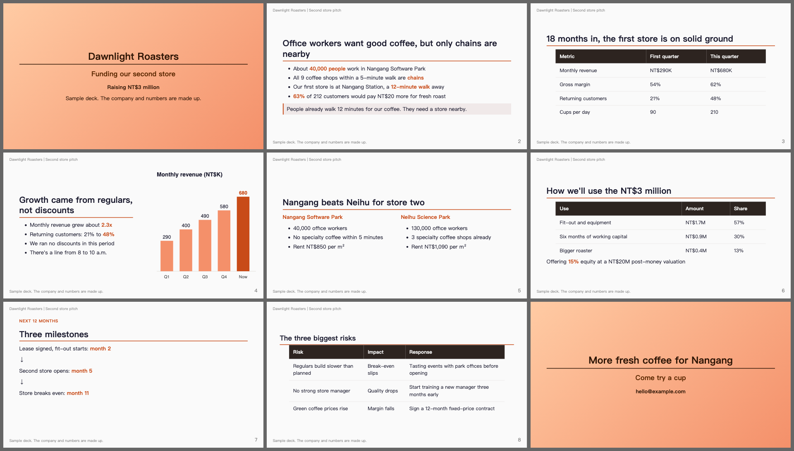
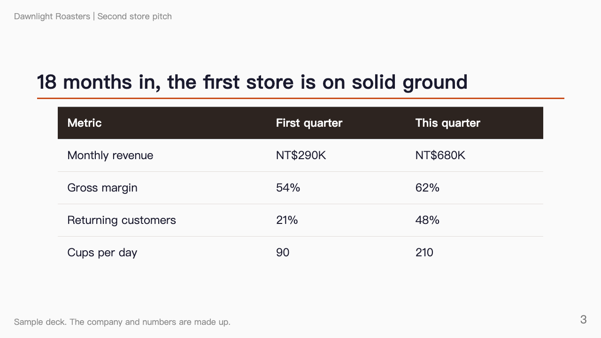
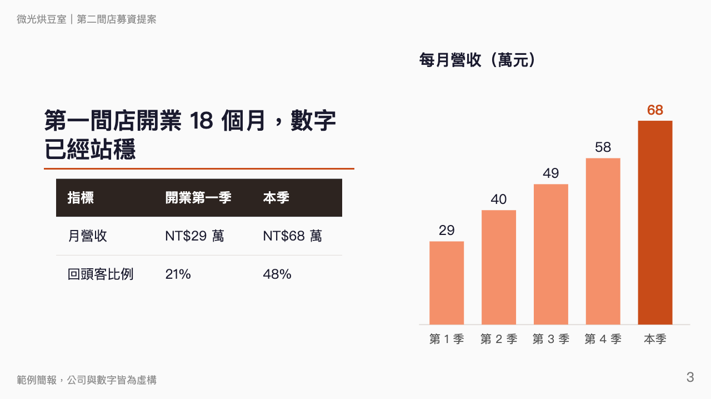

# AI Slide Maker

告訴 AI 你要講什麼，它做出能直接上台的投影片。之後想改哪一頁，用講的就好。

[English](README.md) | [简体中文](README.zh-CN.md)



*用這個工具做的範例簡報，公司與數字皆為虛構。可以看[原始檔](examples/demo/slides.md)和 [PDF](examples/demo/slides.pdf)。*

**安裝：** 把這段貼進 Claude Code。

> 幫我安裝 AI Slide Maker 這個 plugin：https://github.com/yyu0310/ai-slide-maker ，並確認這台電腦有 Python 3、Node.js 和 Chrome。

## 想改哪頁，用講的

用平常說話的方式講就好。AI 會直接找到那一頁，只改你說的地方。

| 你說 | 結果 |
| --- | --- |
| 「刪掉第 7 頁的表格」 | 只有那張表格被刪掉 |
| 「把所有『客戶』換成『會員』」 | 投影片和講稿裡的全部換掉 |
| 「第 3 頁改成左文右圖」 | 版面換掉，其他內容不動 |
| 「風險表格的第三列拿掉」 | 那一列刪掉，標題的「三個風險」也一起更新 |

下面是一次真實修改，對象是範例簡報第 3 頁：*「第 3 頁改成左文右圖，表格只留兩列。」*

| 修改前 | 修改後 |
| --- | --- |
|  |  |

### 為什麼改得動

整份簡報就是一個文字檔。AI 能直接找到那一行，也能搜尋全檔確認沒有漏改；樣式都集中在一個地方，排版不會越改越亂，也不用手動對齊方塊。

底層用的是開源工具 [Marp](https://marp.app)，它把文字檔變成投影片。你不需要學它。

## 可以做什麼

| 你想要 | 怎麼做 | 會發生什麼 |
| --- | --- | --- |
| 開始一份新簡報 | `/ai-slide-maker:new` | AI 先問聽眾是誰、講多久，跟你定好大綱，再做投影片 |
| 修改內容 | 直接講 | AI 找到那一頁，改完確認沒有壞掉 |
| 聽聽真實意見 | `/ai-slide-maker:review` | 三種讀者看過整份簡報：挑剔的專家、第一次聽的人、正在排練的你 |
| 拿到最後的檔案 | `/ai-slide-maker:export` | 先跑檢查，再做出 PDF，需要的話也有 PowerPoint |

審稿提出的每個問題都逐字引用你的簡報。程式會確認引用真的在檔案裡，並附上行號，你不用追查憑空想出來的問題。

範例簡報的初稿收到 30 條意見，30 條引用全部對得上。其中一條：第 6 頁說店租低，第 7 頁的講稿卻說回本慢是因為店租高。

## 上台前幫你抓的問題

| 問題 | 你會看到 |
| --- | --- |
| 內容太多，頁面下方被切掉，而且沒有任何提醒 | 第幾頁、超出多少、建議怎麼修 |
| 文字壓到頁首或頁尾 | 第幾頁 |
| 給自己的提醒留在投影片上，例如「這個數字待確認」 | 那一行，並提醒你移到講稿 |
| 字太小，投影時看不清楚 | 第幾頁 |
| 草稿標記或模板文字沒換掉 | 那一行 |
| 圖片檔案不見 | 那一行和路徑 |
| 引用簡報資料夾以外的檔案，會被帶進 PDF | 那一行，並在匯出前停下來 |
| 講稿在 PowerPoint 檔裡不見 | 有幾頁保留了講稿 |

`/ai-slide-maker:export` 還會做出 `slides.sheet.png`，所有投影片並排在一張圖上，有問題的頁面一眼就看得出來。

## 怎麼做一份簡報

作者自己的流程分成四步：

1. **題目與受眾：** 寫一句話，讓誰在多少時間內學到什麼。
2. **內容大綱：** 選一種結構，定好每段的訊息、例子和時間。
3. **製作投影片：** 一段一段做，請人審過，再匯出。
4. **上台當天：** 自備轉接頭和兩份備份，提早到場。

第 1、2 步已經做進 `/ai-slide-maker:new`。[完整流程在這裡](docs/workflow.zh-TW.md)。

## 安裝

### 交給 AI

把本頁最上面那段貼進 Claude Code。

### 自己來

在終端機執行：

```bash
claude plugin marketplace add yyu0310/ai-slide-maker
claude plugin install ai-slide-maker@ai-slide-maker
```

接著開一個新的 Claude Code 對話，試試 `/ai-slide-maker:new`。

### 需要準備什麼

不確定有沒有裝？請 AI 幫你檢查，缺的也可以請它協助安裝。

| 項目 | 用途 |
| --- | --- |
| [Claude Code](https://code.claude.com) | 負責執行一切 |
| Python 3.9 以上 | 跑檢查 |
| Node.js | 產生投影片。第一次匯出會下載工具，需要連網一次 |
| Chrome、Chromium 或 Edge | 實際畫出每一頁，檢查有沒有被切掉。裝在特殊位置的話，設定 `CHROME_PATH` |

### 支援範圍

| 環境 | 狀態 |
| --- | --- |
| macOS 上的 Claude Code | 已測試 |
| Linux 上的 Claude Code | 理論上相同，未實測 |
| Windows 上的 Claude Code | 未實測，要設定 `CHROME_PATH` 指向瀏覽器 |
| 其他 AI 編程工具，例如 Codex、Gemini CLI | 模板和腳本理論上可用，未實測。`/` 指令只有 Claude Code 能用，請讓工具讀 [AGENTS.md](AGENTS.md) |
| 瀏覽器上的 claude.ai | 無法使用，因為 plugin 要在你的電腦上執行程式 |

## 限制

- PowerPoint 檔的每一頁是一張圖。版面完全一致，講稿也會保留，但文字不能在 PowerPoint 裡改，要改原始檔再匯出一次。
- PDF 沒有動畫。
- 影片無法嵌入，要在 PowerPoint 手動加入。
- 風格簡潔。視覺設計很重、品牌導向的簡報不適合。
- 簡報可以要求電腦裡任何位置的檔案，匯出時會被帶進去。檢查遇到這種情況會停下來，別人給你的簡報請先看完警告再匯出。
- 檢查只看排版和殘留文字，判斷不了論點對不對。論點的問題交給 `/ai-slide-maker:review`。

## 更多文件

- [投影片製作指南](docs/guide.zh-TW.md)：何時拆頁、圖片怎麼放、每項檢查的意思
- [模板](template/slides.md)

## 致謝

建立在 Marp 團隊開發的 [Marp](https://marp.app) 之上。溢版容許值與修法建議參考 [CopilotAtelier](https://github.com/raandree/CopilotAtelier)，小字檢查參考 [minorun-marp-skill](https://github.com/minorun365/minorun-marp-skill)。

## 授權

[MIT](LICENSE)
