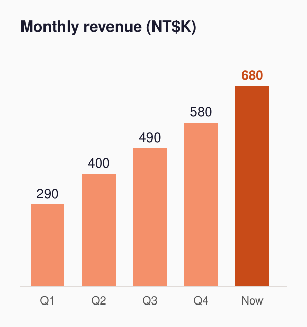

<!-- _class: lead -->
<!-- _paginate: false -->
<!-- _header: '' -->
<!-- _footer: '' -->

# Dawnlight Roasters

## Funding our second store

**Raising NT$3 million**

Sample deck. The company and numbers are made up.

<!--
Thanks for having me. In the next ten minutes I'll show why now is the right time for a second store.
-->

---

# Office workers want good coffee, but only chains are nearby

- About **40,000 people** work in Nangang Software Park
- All 9 coffee shops within a 5-minute walk are **chains**
- Our first store is at Nangang Station, a **12-minute walk** away
- **63%** of 212 customers would pay NT$20 more for fresh roast

> People already walk 12 minutes for our coffee. They need a store nearby.

<!--
The survey covered 212 customers at our first store, so it leans toward people who already love coffee. Say so if asked.
-->

---

# 18 months in, the first store is on solid ground

| Metric | First quarter | This quarter |
|---|---|---|
| Monthly revenue | NT$290K | NT$680K |
| Gross margin | 54% | 62% |
| Returning customers | 21% | 48% |
| Cups per day | 90 | 210 |

<!--
Margin went up because we started roasting our own beans. Returning customers come from the membership app.
-->

---

# Growth came from regulars, not discounts

- Monthly revenue grew about **2.3x**
- Returning customers: 21% to **48%**
- We ran no discounts in this period
- There's a line from 8 to 10 a.m.

<!--
Morning waits average 11 minutes and we're starting to lose customers. Most of that rush is office workers from the park, so a second store takes the pressure off.
-->

---

# Nangang beats Neihu for store two

**Nangang Software Park**

- 40,000 office workers
- No specialty coffee within 5 minutes
- Rent NT$850 per m²

**Neihu Science Park**

- 130,000 office workers
- 3 specialty coffee shops already
- Rent NT$1,090 per m²

<!--
Neihu has more people, but also more specialty coffee. Nangang has no direct competitor, and its rent is lower than Neihu's.
-->

---

# How we'll use the NT$3 million

| Use | Amount | Share |
|---|---|---|
| Fit-out and equipment | NT$1.7M | 57% |
| Six months of working capital | NT$0.9M | 30% |
| Bigger roaster | NT$0.4M | 13% |

Offering **15%** equity at a NT$20M post-money valuation

<!--
We expect payback 16 months after opening, two months slower than the first store, because rent in the park is higher than at the station. The bigger roaster lets us supply both stores.
-->

---

<!-- _class: top -->

NEXT 12 MONTHS

# Three milestones

Lease signed, fit-out starts: **month 2**

↓

Second store opens: **month 5**

↓

Store breaks even: **month 11**

<!--
If we haven't broken even by month 11, we'll cut to morning and lunch hours to lower staff costs.
-->

---

<!-- _class: dense -->

# The three biggest risks

| Risk | Impact | Response |
|---|---|---|
| Regulars build slower than planned | Break-even slips | Tasting events with park offices before opening |
| No strong store manager | Quality drops | Start training a new manager three months early |
| Green coffee prices rise | Margin falls | Sign a 12-month fixed-price contract |

<!--
Investors ask about these three most. The first matters most: returning customers need to reach 30% by month six after opening.
-->

---

<!-- _class: lead -->
<!-- _paginate: false -->
<!-- _header: '' -->
<!-- _footer: '' -->

# More fresh coffee for Nangang

## Come try a cup

**hello@example.com**

<!--
Please come by the store and taste what we're doing.
-->
