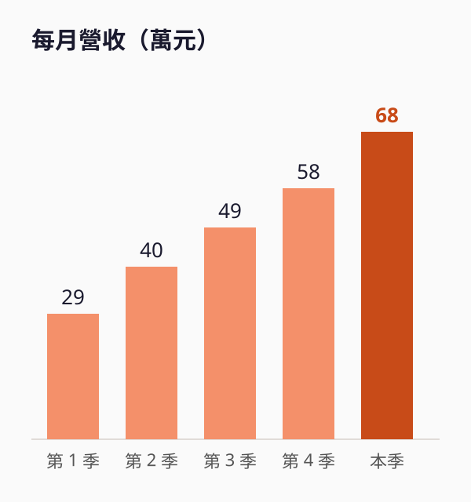

<!-- _class: lead -->
<!-- _paginate: false -->
<!-- _header: '' -->
<!-- _footer: '' -->

# 微光烘豆室

## 第二間店募資提案

**種子輪 NT$300 萬**

範例簡報，公司與數字皆為虛構

<!--
大家好，我是微光烘豆室的創辦人。接下來十分鐘，我會說明為什麼現在是開第二間店的時機。
-->

---

# 上班族想喝好咖啡，附近卻只有連鎖店

- 南港軟體園區上班人口約 **4 萬人**
- 園區步行 5 分鐘內的 9 間咖啡店**全是連鎖店**
- 第一間店在南港車站，園區客人要走 **12 分鐘**
- 第一間店 212 位客人中，**63%** 願意為現烘豆多付 20 元

> 客人已經願意走 12 分鐘來買，缺的是走得到的店。

<!--
問卷做在第一間店的客人身上，共 212 份。這個樣本偏向已經愛喝咖啡的人，被問到時要主動說明。
-->

---

# 第一間店開業 18 個月，數字已經站穩

| 指標 | 開業第一季 | 本季 |
|---|---|---|
| 月營收 | NT$29 萬 | NT$68 萬 |
| 毛利率 | 54% | 62% |
| 回頭客比例 | 21% | 48% |
| 每日杯數 | 90 杯 | 210 杯 |

<!--
毛利率提升來自自己烘豆，不再外購熟豆。回頭客比例是用會員 App 算的。
-->

---

<!-- _class: part -->
<!-- _paginate: false -->

# 為什麼是現在

## 也說明為什麼選南港

---

# 成長來自回頭客，不是促銷

- 月營收從 29 萬變成 68 萬，約 **2.3 倍**
- 同期回頭客比例從 21% 升到 **48%**
- 這段期間沒有打折活動
- 上午 8 點到 10 點已經排隊

<!--
上午尖峰的等待時間平均 11 分鐘，已經開始流失客人。尖峰的主力是園區上班族，第二間店可以直接分流。
-->

---

# 南港比內湖更適合第二間店

**南港軟體園區**

- 上班人口 4 萬人
- 步行 5 分鐘內沒有精品咖啡店
- 店租每坪 NT$2,800

**內湖科技園區**

- 上班人口 13 萬人
- 已有 3 間精品咖啡店
- 店租每坪 NT$3,600

<!--
內湖人更多，但精品咖啡店也更多。我們選擇沒有直接對手、店租也比內湖低的南港園區。
-->

---

# NT$300 萬怎麼用

| 用途 | 金額 | 占比 |
|---|---|---|
| 店面裝修與設備 | NT$170 萬 | 57% |
| 六個月營運週轉 | NT$90 萬 | 30% |
| 烘豆機擴充 | NT$40 萬 | 13% |

出讓 **15%** 股權，投後估值 NT$2,000 萬

<!--
預計開幕後第 16 個月回本，比第一間店慢兩個月，因為園區店租比車站店高。烘豆機擴充是為了同時供應兩間店。
-->

---

<!-- _class: top -->

接下來 12 個月

# 三個里程碑

簽約並開始裝修：**第 2 個月**

↓

第二間店開幕：**第 5 個月**

↓

單店損益兩平：**第 11 個月**

<!--
如果第 11 個月沒有損益兩平，我們會先把營業時間縮到早午，降低人事成本。
-->

---

<!-- _class: dense -->

# 三個最大的風險

| 風險 | 影響 | 對策 |
|---|---|---|
| 回頭客養成比預期慢 | 損益兩平延後 | 開幕前與園區公司合作試喝 |
| 店長人選不到位 | 品質下降 | 提前三個月培訓新店長 |
| 咖啡生豆漲價 | 毛利率下滑 | 簽十二個月固定價合約 |

<!--
這三項是投資人最常問的。第一項最關鍵，回頭客比例要在開幕第六個月達到 30%。
-->

---

<!-- _class: lead -->
<!-- _paginate: false -->
<!-- _header: '' -->
<!-- _footer: '' -->

# 讓南港多一杯現烘咖啡

## 歡迎約時間試喝

**hello@example.com**

<!--
最後請大家來店裡喝一杯，實際感受我們在做的事。
-->
